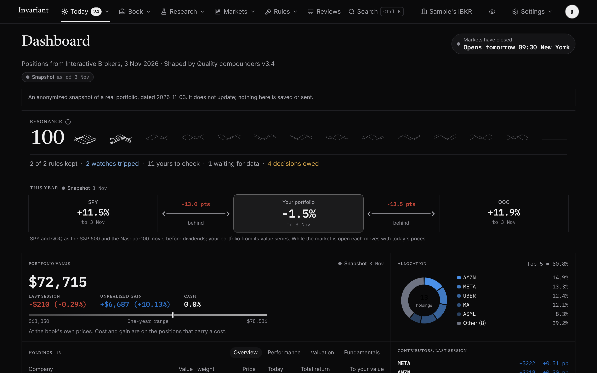
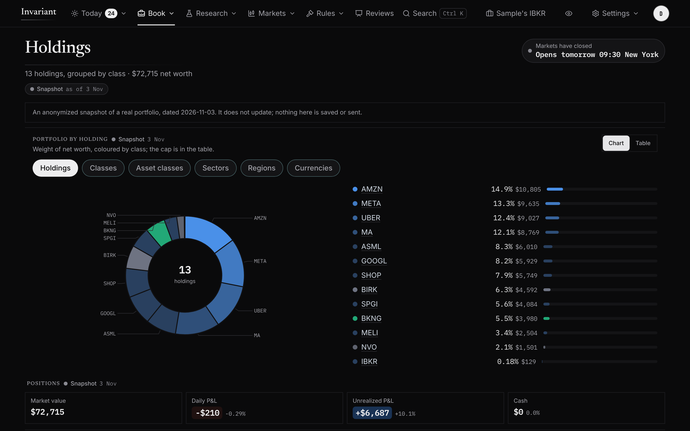
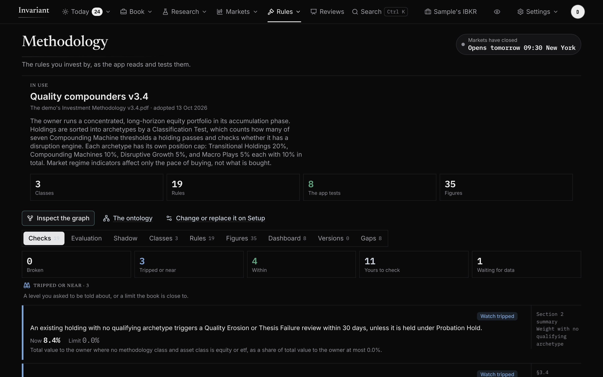
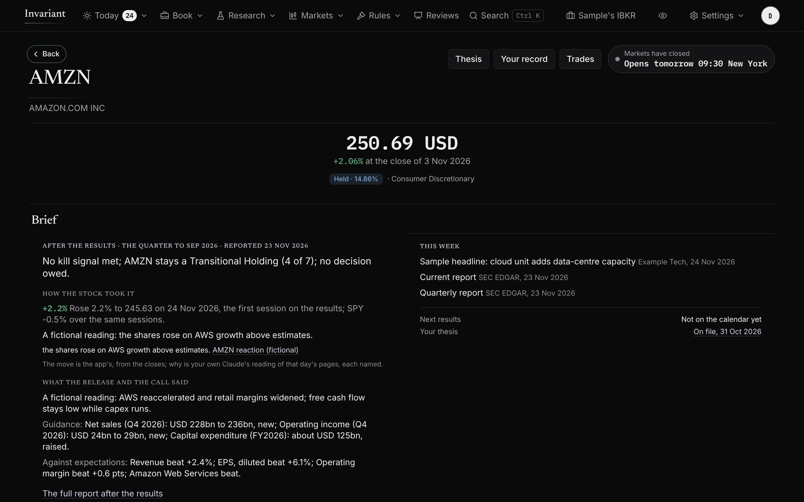
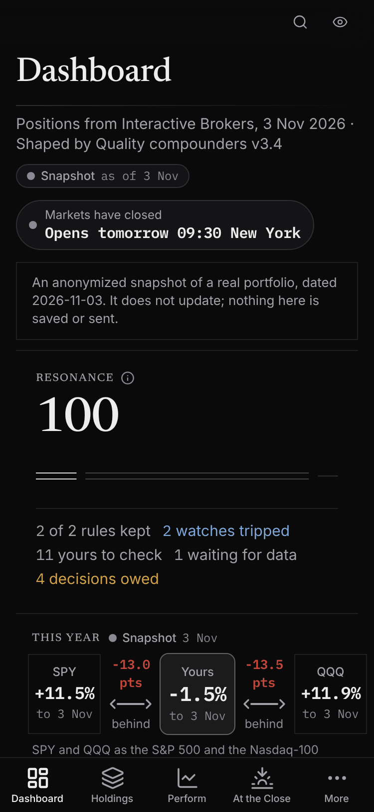
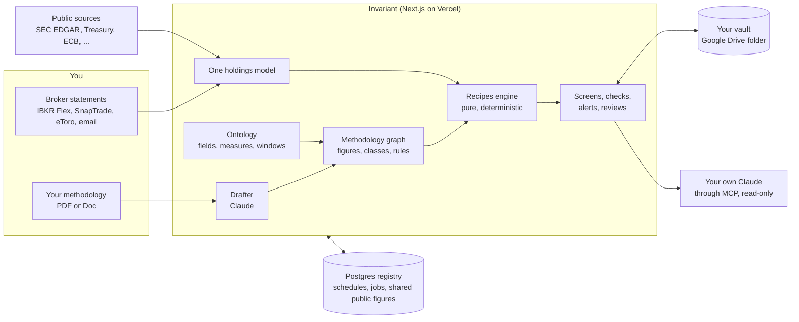

# Invariant

**Markets move. Your rules don't.**

Invariant is a read-only portfolio console that judges your book against the
investment methodology you wrote yourself. You give it the document you invest
by; it turns that document into classes, caps, rules and figures, builds every
screen from them, and checks your holdings against them twice a day. Every
verdict cites the section of your rules it came from. It never trades.

[](LICENSE)
[](https://nextjs.org)
[](https://www.anthropic.com/claude)

[Try the demo](https://portfolio-os-demo.vercel.app/try) · [Run your own](#run-your-own) · [How it works](#how-it-works) · [Data sources](#data-sources-and-their-terms)



> Not investment advice. Invariant tells you what your own rules say about
> your own portfolio. You decide.

---

## Why it exists

Most investors already know their rules. They break them anyway, in a hot
market or a bad week. Invariant was built by one investor to hold himself to
his own written methodology: caps per class of holding, a classification test
run on every new filing, sell triggers, a reason logged for every trade. It
then grew into an app anyone can point at their own rules.

The name comes from mathematics: an invariant is what stays the same whatever
you do to it.

## What it does

| | |
| :-- | :-- |
| **Your methodology becomes the app** | Upload the document you invest by, or start from one in the library (Graham, Greenblatt, Lynch, dividend growth). Claude drafts it as recipes over a fixed ontology; nothing takes effect until you confirm it. |
| **Every rule checked, every rule cited** | Rules are tested on the figure they name and cite their section (`§3.1 Caps`). A rule the app cannot measure is shown as yours to check, never as passing. |
| **Your broker, as it is** | Interactive Brokers through its Flex statement, Schwab, Fidelity, Robinhood, Wealthsimple and others through your own SnapTrade key, eToro, and bank or fund statements by email. All read-only. |
| **Results, read for you** | After a company reports, the filing is read from the SEC, tested against your class and kill signals, and written up as a report with the call, the guidance and how the stock took it. |
| **Theses that stay current** | A thesis per holding with the pillars that would break it, scored on each new filing, and a weekly hunt for evidence for and against. |
| **Valuation by stage** | The metrics that matter for a company's stage, a DCF seeded from its filings, and five years of its own multiple to set today against. |
| **Live in market hours** | Prices, the day's movers and your book against SPY and QQQ during the session, with why each holding moved written after the close. |
| **Reviews that grade behaviour** | Weekly and monthly reviews, as a page and a PDF, judge how you kept your rules, not how the index did that week. |
| **Inside your own Claude** | An MCP server lets Claude or ChatGPT read your book, rules and theses. The app computes every figure; the assistant only reads them. |

<table>
  <tr>
    <td></td>
    <td></td>
  </tr>
  <tr>
    <td></td>
    <td></td>
  </tr>
</table>

## Three hard rules

The code holds itself to these, and `npm run check:guard` fails the build when
any of them is broken.

1. **Read-only outside your own vault.** No code path places, changes or
   cancels an order, creates an alert at a broker or writes to a bank. The
   only writes go to your own vault, a folder in your Google Drive under the
   `drive.file` scope. The only email goes to your own sign-in address.
2. **Each person sees only their own data.** Your figures are read with your
   own token from your own Drive. The deployment keeps your sign-in, your
   schedule and an encrypted refresh token, never a figure of your money.
   Money data never goes in a URL, a log line or an analytics event.
3. **Cite the rule.** Every check names the section of your methodology it
   comes from and the figure it tests. A figure that needs data says which
   input would supply it, never a zero.

## How it works



The design in one paragraph: **the model writes, the app computes.** A
methodology is data, never generated code. Claude reads your document once and
writes it as recipes over a fixed vocabulary (`lib/ontology.ts`): which fields
to read, how to measure them, how to group holdings, which comparator a rule
uses. `lib/recipes.ts` computes every figure and verdict deterministically
from those recipes and your holdings. No screen is written for one investing
style: an options seller gets premium and assignment risk, a dividend
investor gets income and safety, because their methodologies asked for them.
When a methodology asks for something the ontology cannot express yet, it is
recorded as a gap, shown to you, and becomes a change to the ontology for
everyone.

| Layer | Where | What it decides |
| :-- | :-- | :-- |
| Ontology | `lib/ontology.ts` | Objects, fields with their type and supplier, measures, windows, groupings, comparators, every screen and slot and the condition that draws it |
| Recipes | `lib/recipes.ts` | How figures, classes and tests are written in that vocabulary, and computed |
| Methodology | `lib/methodology.ts` | The graph of figures, classes, rules and dashboard; `evaluate()` runs the checks |
| Screens | `lib/screens.ts`, `lib/screen-data.ts` | Which screens and slots a methodology and a book switch on |
| Holdings | `lib/holdings.ts`, `lib/adapters/` | One model for every source; each adapter turns a broker's shape into it |
| Filings | `lib/edgar.ts`, `lib/edgar-facts.ts`, `lib/edgar-segments.ts` | SEC company facts and XBRL into the ontology's fields, splits and currencies handled, nothing estimated |
| Vault | `lib/vault.ts`, `lib/user-drive.ts` | The person's own Drive folder, OneDrive app folder or bucket |
| Registry | `lib/registry.ts`, `lib/jobs-run.ts` | Postgres: schedules, the job queue, the AI meter, public company figures read once for everyone |
| AI | `lib/hosted-model.ts`, `lib/methodology-draft.ts`, `lib/agent-ledger.ts` | One Anthropic key, metered and capped per person, every call gated and counted by agent |
| MCP | `lib/mcp.ts`, `lib/mcp-tools.ts`, `lib/mcp-auth.ts` | The read-only server a person's own Claude connects to, with its own OAuth 2.1 |

Pure logic lives in pure modules that import nothing server-only, so the same
code runs in the browser, on the server and in the checks. The full map, with
every decision and its date, is in [`AGENTS.md`](AGENTS.md);
[`docs/ARCHITECTURE.md`](docs/ARCHITECTURE.md) and [`docs/adr/`](docs/adr)
hold the architecture and its decision records.

**Stack:** Next.js 16 (App Router, server actions), React 19, TypeScript,
Tailwind CSS 4, Auth.js, Neon Postgres, the Claude API with LangChain for the
analyst's agent loop, react-pdf, Web Push, deployed on Vercel.

## Try the demo

The public demo runs the same app on a frozen, anonymised portfolio with a
guided tour. It never signs anyone in, never touches Drive and never calls a
model: [portfolio-os-demo.vercel.app/try](https://portfolio-os-demo.vercel.app/try).

To run it locally (Node 22 or later):

```bash
git clone https://github.com/hamzabass16/invariant.git
cd invariant
npm ci
STORAGE=demo DEMO_PUBLIC=1 AUTH_SECRET=dev npm run dev
```

Then open http://localhost:3000/try.

## Run your own

Everyone who runs Invariant brings their own accounts: a Vercel project, a
Postgres database, a Google OAuth client and an Anthropic API key. Nothing is
shared with the author or anyone else, and each person's portfolio stays in
their own Google Drive.

### The demo, in one click

[](https://vercel.com/new/clone?repository-url=https%3A%2F%2Fgithub.com%2Fhamzabass16%2Finvariant&project-name=invariant-demo&env=STORAGE,DEMO_PUBLIC,AUTH_SECRET&envDescription=Set%20STORAGE%3Ddemo%2C%20DEMO_PUBLIC%3D1%20and%20AUTH_SECRET%20to%20any%20long%20random%20value&envLink=https%3A%2F%2Fgithub.com%2Fhamzabass16%2Finvariant%2Fblob%2Fmain%2F.env.example)

Set `STORAGE=demo`, `DEMO_PUBLIC=1` and any long random `AUTH_SECRET`. No
other account is needed.

### Your own instance

[](https://vercel.com/new/clone?repository-url=https%3A%2F%2Fgithub.com%2Fhamzabass16%2Finvariant&project-name=invariant&env=STORAGE,AUTH_SECRET,AUTH_GOOGLE_ID,AUTH_GOOGLE_SECRET,ALLOWED_EMAILS,OPERATOR_EMAILS,DATABASE_URL,REPORT_KEY,ANTHROPIC_API_KEY,CRON_SECRET&envDescription=What%20each%20setting%20is%20and%20where%20to%20get%20it&envLink=https%3A%2F%2Fgithub.com%2Fhamzabass16%2Finvariant%2Fblob%2Fmain%2F.env.example)

1. **Database.** Make a free project at [Neon](https://neon.tech) (or add Neon
   from the Vercel Marketplace, which sets `DATABASE_URL` for you). The tables
   make themselves on first use; there is no migration to run.
2. **Google sign-in and Drive.** In [Google Cloud](https://console.cloud.google.com),
   make an OAuth 2.0 Client ID (Web application), enable the Google Drive API
   and add the `drive.file` scope to the consent screen. Add the redirect URIs
   `https://<your-domain>/api/auth/callback/google` and
   `https://<your-domain>/api/vault/google/callback`. Publish the consent
   screen: in Testing, Google ends Drive access every seven days.
3. **Anthropic.** Make an API key at [console.anthropic.com](https://console.anthropic.com).
   Every model call runs on it, capped per person per month (`MODEL_CAP_USD`,
   US$15 by default). Without a key the app still runs: figures, checks and
   alerts never call a model.
4. **Secrets.** Generate `AUTH_SECRET`, `REPORT_KEY` and `CRON_SECRET`:
   ```bash
   node -e "console.log(require('crypto').randomBytes(32).toString('base64'))"
   ```
5. **Deploy** with the button above, or `vercel deploy`, and set
   `STORAGE=drive`, your own address in `ALLOWED_EMAILS` and
   `OPERATOR_EMAILS`, and the values from steps 1 to 4.
6. **Optional:** mail for reports and alerts (`MAIL_*`), an inbox for
   forwarded statements and newsletters (`INBOX_*`), push notifications
   (`VAPID_*`), Microsoft sign-in, and sign-up for other people
   (`SIGN_UP=invite` or `open`). Every setting is described in
   [`.env.example`](.env.example).

Sign in, and Welcome walks you through the rest: where your money is reported,
your methodology, and a thesis per holding. Every input has a step-by-step
guide in the app.

### Vercel Hobby or Pro

The repository is tuned for **Vercel Pro**: crons every quarter hour during
results season and functions of up to 800 seconds. On the free **Hobby** plan
each cron runs once a day and a function stops at 300 seconds, so fit your
fork to it once and commit the result:

```bash
node scripts/hobby-plan.mjs
```

You keep every screen and check; results are read the next morning instead of
within the quarter hour, and a review goes out with the morning run.

### What it costs

For one person or a small group: Vercel Hobby and Neon's free tier cost
nothing; the Anthropic key is billed by use, and the per-person cap bounds it.
[`docs/ARCHITECTURE.md`](docs/ARCHITECTURE.md) estimates the running cost at
larger scale.

## Data sources and their terms

Invariant reads only public, keyless sources and the keys each person gives
it for their own accounts. Some free sources allow personal use but not an app
run for other people. The switch is one setting:

- **A deployment only you use:** leave `SOURCES` unset and every source below
  is read, under each source's own terms for personal use.
- **A deployment other people sign in to:** set `SOURCES=licensed`. Only the
  sources whose terms allow an app run for others are asked, each credited
  where it is drawn, and every card that loses a source says so.
  `lib/licences.ts` holds the list and is the one place to change it.

| Source | Used for | `SOURCES=licensed` |
| :-- | :-- | :-- |
| SEC EDGAR | Filings, company figures, insider trades, 13F, N-PORT, results releases | Read (public filings) |
| US Treasury, BLS, BEA, Federal Reserve, CFTC, OFR | Yields, macro series, positioning, foreign buying, money market funds | Read (US government work, credited) |
| FRED | US government series only | Read for those series; others shut |
| New York Fed, Freddie Mac | Reference rates, mortgage survey | Read (with credit) |
| ECB, OECD, BIS, IMF | Currency rates, major economies, policy rates | Read (with credit) |
| Wikipedia | Index membership and sectors | Read (CC BY-SA, credited) |
| Yahoo Finance, stooq | Prices, closes, extended hours, headlines | Shut: personal use only |
| Nasdaq | Earnings calendar, market values, analysts' estimates | Shut |
| Cboe, FINRA | Options' expected move, short interest | Shut |
| Kalshi, Polymarket | Prediction market odds | Shut |
| CNN, University of Michigan, multpl, Google News, podscripts.co | Fear and greed, sentiment, S&P earnings, news, podcast transcripts | Shut |

These are summaries of each source's terms as read on 9 November 2026, not
legal advice; check the terms yourself before you run Invariant for others.

**Keys each person brings.** Broker access is never the deployment's: each
person pastes their own read-only IBKR Flex token, their own free SnapTrade
Personal key and their own eToro read keys on Setup, and they are kept in that
person's own vault. The SEC asks every automated client for a contact address;
each person types theirs on Setup, and the deployment's reads use
`SEC_CONTACT`.

## Development

```bash
npm ci
cp .env.example .env.local   # STORAGE=demo works with no other value
npm run dev
```

Before and after a change, run the checks. Each `check:*` script holds one
part of the app to hand-worked cases with no network and no key:

```bash
npm run typecheck && npm run lint
npm run check:guard      # the three hard rules
npm run check:setup      # recipes against hand-worked figures
npm run check:screens    # which screens and slots each methodology draws
npm run build && npm run smoke   # every demo setup at 375px and 1440px
```

The full list is in `package.json`; CI runs all of them on every pull
request. `npm run synth:loop` runs fictional investors through the real
pipeline and has a judge name what the ontology cannot say yet, on a key in
`.env.local`.

### How it was built

Invariant was designed by one person and written with
[Claude Code](https://claude.com/claude-code) over about 200 pull requests.
[`AGENTS.md`](AGENTS.md) is the brief every coding session reads: the rules,
the conventions and every product decision with its date. It is kept in the
repository as it was used, so you can see how the app was specified.

## Licence

[MIT](LICENSE). Use it, fork it, run it for yourself or for others. The
methodologies in `data/library/` are summaries of published frameworks,
credited to their authors, and of the author's own methodology.

Invariant is not investment, tax or legal advice, and comes with no warranty.
