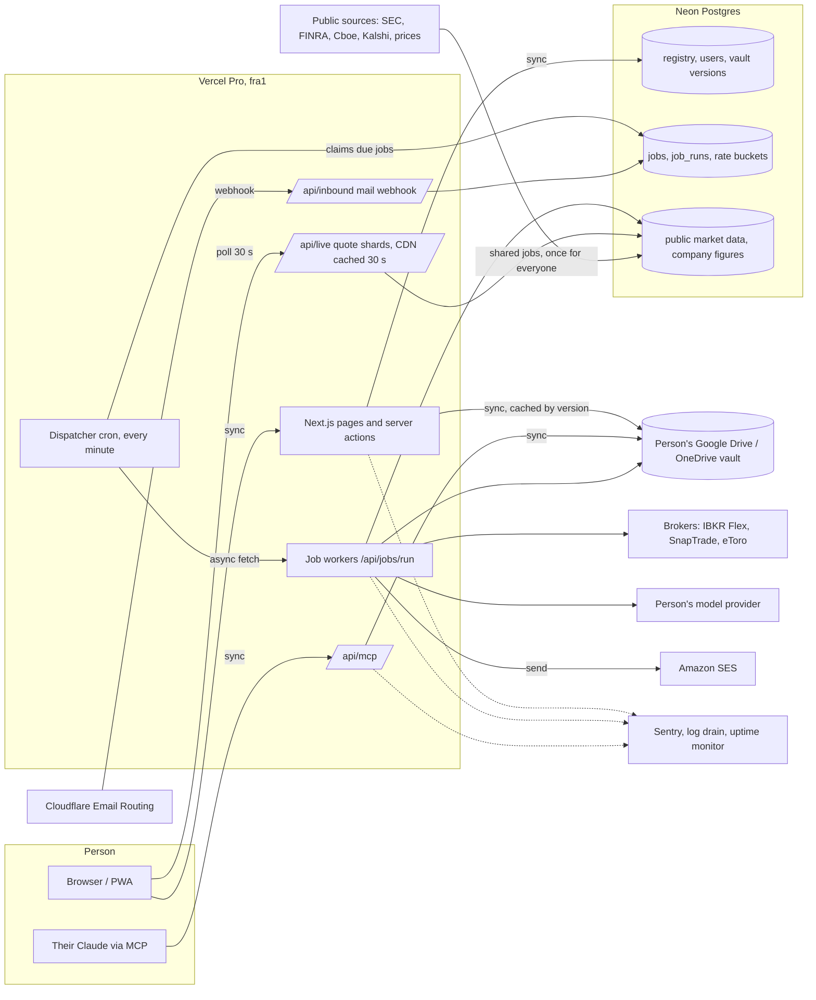

# PortfolioOS architecture for 10,000 users

Status: proposed 2 Nov 2026; parts built 2 to 4 Nov 2026 (section 8 says
which). Vercel Pro since 4 Nov 2026.
Goal set by Hamza: enterprise-grade operation and monitoring for 10,000
users, "for maximum efficiency and minimal cost".

`DESIGN.md` at the root is the visual design. This file is the system
design. Decision records are in `docs/adr/`.

## 1. The short version

The app's shape is right for 10,000 people: stateless Next.js, each
person's money in their own Drive, model calls on their own key. What
breaks first is not the app server but four things around it:

1. **The scheduled runs.** Every cron walks every enrolment one after
   another inside one 300 s function (`runMorningSync`, `runDueReports`,
   `runAlertChecks`). At about 5 to 30 s a person this stops finishing at
   roughly 15 to 50 people. Fix: a job queue in Postgres, one job per
   person, fanned out by a per-minute dispatcher.
2. **Google Drive quota.** A screen reads about 23 vault files, each a
   separate download, plus a listing. At 10,000 people that crosses
   Drive's per-project daily threshold. Fix: bundle the 43 vault keys into
   4 files and skip Drive entirely when a per-person version number in
   Postgres says nothing changed.
3. **Email.** Outbound goes through one Gmail account (about 500 sends a
   day) and inbound statements and newsletters through one Gmail inbox
   polled by IMAP. Fix: Amazon SES out, Cloudflare Email Routing in, on
   the app's own domain.
4. **No operations layer.** No CI, no error tracking, no retained logs
   (Hobby keeps none), no job history. Fix: structured logs, Sentry, a
   `job_runs` table and an operator screen, all on free tiers.

Plus two non-technical walls: **Vercel Hobby forbids commercial use**, and
**Yahoo, Nasdaq, CNN and Wikipedia reads are unlicensed** for a commercial
app showing prices to 10,000 people.

Estimated running cost at 10,000 users: **about US$200 to 400 a month**
(US$0.02 to 0.04 per user), excluding any market data licence. Section 9.

## 2. Requirements and assumptions

Answers are taken from AGENTS.md and project memory; where none exists
the default is marked (A).

| Question | Answer |
|---|---|
| Who, how many, where | 10,000 registered individuals and family offices, worldwide, mostly Europe and the US (A) |
| Daily active | 30% (3,000) (A); peak hour 25% of them (750) around the US open and close (A) |
| Core reads | Dashboard, Holdings, Performance, At the Close, Notifications, company pages, MCP tools |
| Core writes | Setup and uploads, theses, Decision Log, preferences, alerts read state, everything the scheduled runs write |
| Read:write | About 50:1 for people; the scheduled runs are almost all writes |
| Freshness | Live prices every 30 s in US hours; book daily (Flex overnight); filings daily; recap after each close |
| Latency | Main screen under 1.5 s p95 including Drive (A) |
| Uptime | 24/7, 99.5% a month (A). An hour down costs a late page, never money: the app never trades |
| Sensitive data | Positions, values, statements, model keys, broker tokens. All in the person's own vault, never in the deployment, never in a log or URL |
| Sign-in | Google, Microsoft, email and password with a code |
| Who runs it | Hamza alone. Every recurring job must run and recover by itself |

## 3. Numbers

### Requests
- Browsing: 750 peak users x 0.25 req/s = **about 190 req/s** at peak.
- Live polling: 750 x 1/30 s = **25 req/s**, in US hours only.
- Tier 1 in the skill's table: one app plus managed Postgres, a job
  queue, a cache for external calls, connection pooling. No replicas, no
  Redis, no sharding needed.

### Google Drive quota (the first hard wall)
Drive meters **quota units**: per the [Drive limits page](https://developers.google.com/drive/api/guides/limits),
about 1,000,000 units a minute per project, 325,000 per user per minute,
a list costs 100, a download 200, an edit 50, and a daily threshold of
400,000,000 units per project that cannot be raised. (These figures came
from a summary of the page; confirm them on the Cloud console's Quotas
page before relying on them.)

Today a screen does 1 listing + about 23 downloads = **4,700 units**.

| Load | Today | With 4 bundled files and a version check |
|---|---|---|
| Page views: 3,000 DAU x 20 views | 282 M units/day | about 15 M (half the views served warm, 0 units) |
| Scheduled runs: 10,000 x 8 runs x ~3,500 | 280 M units/day | 10,000 x 8 x ~1,100 = 88 M |
| **Total** | **~560 M: over the 400 M threshold** | **~100 M: a quarter of it** |
| Peak minute (750 users browsing) | 3.5 M units: over 1 M a minute | ~0.2 M |

### Morning refresh window
10,000 Flex fetches at up to 30 s each = 83 hours of waiting. With 100
running at once that is **50 minutes**. Spread over each person's own
hour (they already carry a time zone), the peak is far lower.

### Postgres storage
Registry and users 10,000 x 4 KB = 40 MB; job history 10,000 x 10 a day x
200 B x 30 days = 600 MB; shared market data (closes for ~6,000 symbols x
5 years) about 400 MB; company figures 50 MB. **Under 2 GB, about 4 GB
with indexes**: US$1.40 a month at Neon's US$0.35/GB-month.

### Email
Weekly and monthly reviews about 45,000 a month, alerts and reports about
150,000: **about 200,000 a month**, peaks of 15,000 a day. Gmail allows
about 500 a day.

### Availability
Vercel, Neon and Google Drive in sequence at 99.9% each give about
**99.7%**. A Drive outage leaves screens unreadable, so the warm cache
(section 5.2) also serves the last copy, marked with its age.

## 4. High-level design

What happens when each side is down:

| Arrow | Kind | If the far side is down |
|---|---|---|
| Page to Drive | sync | Serve the warm copy with its age; else the screen's sentence (`SyncError`) |
| Page to Neon | sync | Pages still render from Drive; schedules, community and sign-up by email pause |
| Worker to broker | async | Job retries with backoff; the last good copy stays (already the rule) |
| Worker to public source | async | Per-host circuit breaker; the figure says what it waits for, never a zero |
| Worker to model | async | Job retries twice, then a sentence on the screen (already the rule) |
| Worker to SES | async | Job retries; `mail_claims` stops a double send |
| Mail in to webhook | async | Cloudflare retries; the message is not lost |

## 5. Core components

### 5.1 Two data planes
- **Private plane: the vault.** Everything about a person's money stays
  in their own Drive or OneDrive, as today (hard rule 1). The deployment
  keeps no copy at rest. See [ADR 0001](adr/0001-keep-the-vault-bundle-and-version-it.md).
  **Decided 2 Nov 2026 ([ADR 0006](adr/0006-managed-vault-default.md)):**
  before the paid tier a managed vault (Postgres, a key per person wrapped
  by AWS KMS) becomes the default for new people; Drive stays a choice.
- **Public plane: Postgres.** Everything that is the same for everyone
  (closes, the session, filings, the earnings calendar, odds, 13Fs,
  screener rows) is read **once for everyone** by shared jobs and kept in
  Postgres, never per person. A person's job only lays it on their book.
  `company_figures` already works this way; the rest follows. See
  [ADR 0003](adr/0003-public-data-once-for-everyone.md).

### 5.2 Vault reads
- Bundle the 43 keys into 4 files by how they are read together:
  `core` (setup, preferences, book, portfolios, methodology, records,
  connections, secrets), `activity` (alerts, notifications, sync, push,
  decisions), `research` (filings, earnings, theses, hunter, research
  cache, screener) and `archive` (reports, studies, recaps, newsletters,
  podcasts). Large or rare files (decks, PDFs) stay separate.
- A table `vault_versions (user_id, version bigint, updated_at)`. Every
  write the app makes bumps it in the same step. Only the app can see these
  files (`drive.file`), so the version is authoritative.
- An instance keeps decrypted bundles in an LRU keyed by user and version
  (raise today's 64-entry cap to about 2,000 entries). A page asks Postgres
  for the version (one query, ~2 ms in region) and touches Drive only when
  its copy is older. Fluid compute keeps instances warm, so most views
  cost **0 Drive units**.
- A write goes read-modify-write on one bundle under a Postgres advisory
  lock per user and bundle, so two jobs never overwrite each other.
- Migration: read old single files when no bundle exists, write bundles
  from then on. No person does anything.

### 5.3 Background jobs
See [ADR 0002](adr/0002-jobs-in-postgres.md).
- `jobs (id, user_id null for shared, kind, dedupe_key unique, run_at,
  status, attempts, max_attempts, locked_until, last_error_code,
  created_at, finished_at)`.
- A planner, run by the dispatcher once an hour, inserts each person's
  jobs for the next hour at their own time (`schedule.zone`), spread by a
  hash of their id across the hour. The `dedupe_key` (`morning:<user>:<day>`)
  makes the insert idempotent.
- The dispatcher (Vercel cron, every minute, Pro) claims due jobs with
  `update ... where id in (select ... for update skip locked limit n)`,
  and calls `/api/jobs/run` for each, signed with an HMAC, up to a
  concurrency cap per kind. Each worker runs one job in up to 800 s.
- Retries: exponential backoff with jitter, 1, 4, 16 minutes, then
  `failed`. A lock past `locked_until` is reclaimed (a crashed worker).
- Per-host token buckets in Postgres (`rate_buckets (host, tokens,
  refilled_at)`): SEC at 8 a second (it asks for at most 10), Yahoo,
  Nasdaq, FINRA, Cboe, Kalshi, Polymarket each with their own. A host that
  fails five times in a row rests for 10 minutes (circuit breaker; the
  feed already does this per instance, this makes it shared).
- The existing crons become thin: each enqueues its kind for everyone and
  returns. `catchUpOnOpen` enqueues instead of running inside `after()`,
  and its half-hour throttle moves from an in-memory `Map` to a column
  (`users.last_catch_up_at`, updated with `where ... < now() - 30 min
  returning`), so it holds across instances.

### 5.4 Live prices
- One shared job reads quotes for the union of all held and watched
  symbols each minute in US hours, in batches, into Postgres.
- `/api/live` becomes 32 shards (`/api/live/shard/17`, the symbol's hash
  picks the shard, so no ticker is in a URL) served with
  `Cache-Control: s-maxage=30`. The CDN answers everyone; the origin sees
  about 64 requests a minute **whatever the number of people**. The
  browser applies `liveBook` as today.

### 5.5 Email
See [ADR 0004](adr/0004-email-ses-out-cloudflare-in.md).
- Out: Amazon SES on the app's own domain with SPF, DKIM and DMARC,
  US$0.10 per 1,000 ([SES pricing](https://aws.amazon.com/ses/pricing/)).
  Bounces and complaints come back by webhook and stop sends to that
  address. `lib/report-mail.ts` stays the one mail path; only its
  transport changes.
- In: Cloudflare Email Routing on the same domain, a catch-all to an
  Email Worker that posts the raw message, signed, to `/api/inbound`.
  The person's tag stays the local part. The webhook keeps the message
  encrypted for at most 24 hours in a `mail_inbox` table until the job
  reads it, then deletes it. The `Authentication-Results` check
  (`lib/inbox.ts`) keeps working on Cloudflare's header. IMAP polling and
  the Gmail app password retire. The privacy page must say the message
  is held up to a day.

### 5.6 Auth and security
- Keep NextAuth with JWT sessions (stateless, already so).
- Users get a `uuid` id; tables key on it, not on the email (today
  `report_enrolments` and others use the email as primary key).
- Sign-up abuse: rate limit code sends per address (3 an hour) and per IP
  (10 an hour) in `rate_buckets`; add Cloudflare Turnstile (free) to the
  form. Today a code can be re-sent without limit, which at scale makes
  the app a spam relay.
- Key rotation: sealed values (`REPORT_KEY`, the MCP tokens under
  `AUTH_SECRET`) carry a key id prefix; two keys are accepted during a
  rotation. Today rotating either one signs everyone out of MCP and
  orphans every enrolment.
- Three Postgres roles: `app` (read and write the app's tables), `migrate`
  (DDL), `ops_ro` (read-only, for the operator screen).
- Schema through Drizzle migrations (the package is already a dependency),
  run as a step before a deploy takes traffic. Today the tables are made
  on first use, which cannot evolve safely.
- Vercel Firewall rules on `/api/mcp`, `/api/live`, sign-in and sign-up;
  per-grant MCP limit of 60 calls a minute in `rate_buckets`.
- The `check:guard` rules stay the security boundary and run in CI.

## 6. Observability

See [ADR 0005](adr/0005-observability-on-free-tiers.md).

| Need | Tool | Cost |
|---|---|---|
| Errors with stack traces | Sentry, `beforeSend` strips amounts, emails and tokens | free tier |
| Logs | `lib/log.ts`: one JSON line per event `{ts, level, event, req, user (HMAC of id), job, host, ms, outcome}`; Vercel log drain to Axiom or Better Stack | free tier |
| Job health | `job_runs` table, 30 days | inside Neon |
| Uptime | Better Stack or UptimeRobot on `/api/health` and a new `/api/health/deep` (Neon, queue lag, last shared reads) | free tier |
| Drive quota | Units counted in `lib/user-drive.ts` per minute; Cloud console quota alert at 60% | free |
| Mail | SES bounce and complaint webhooks into `job_runs` | free |

An operator screen, `/ops`, signed in as the operator only, shows per job
kind: queued, running, done and failed in 24 hours, p95 duration, oldest
waiting job; per host: calls, 429s, open breakers; Drive units a minute;
mail sent, bounced and complained; sign-ups a day. Never a person's
figure.

Alerts, by email and push to the operator:

| Signal | Threshold |
|---|---|
| Queue lag (oldest due job) | over 30 min |
| Morning refresh done | under 95% of people by 08:00 their time |
| Job failure rate, any kind | over 5% in an hour |
| Drive 403/429 rate | over 1% in 10 min |
| SES bounce rate / complaints | over 2% / over 0.08% |
| Error spike (Sentry) | 3x the hourly baseline |
| Uptime | 2 failed checks in a row |

SLOs: 99.5% availability a month; page p95 under 1.5 s; morning refresh
done for 99% by 08:00 local; an alert email within 15 minutes of the
check that found it.

## 7. Deploy and environments

**Option A, Vercel Pro + Neon + GitHub, stays.** Nothing at 10,000 needs
a container. The doors stay open: Drive, mail, queue and logging are each
behind one module, so a container on Cloud Run is a later port, not a
rewrite.

- **Vercel Pro, since 4 Nov 2026** ([ADR 0008](adr/0008-vercel-pro-dispatcher.md)):
  the crons and workers take 800 s, the dispatcher runs every minute, and
  the six evening runs land at their minute. It was required before any
  paying user: Hobby is
  "non-commercial personal use only", runs crons once a day within the
  hour, and caps functions at 300 s and 4 hours of CPU a month
  ([limits](https://vercel.com/docs/limits/overview), [cron pricing](https://vercel.com/docs/cron-jobs/usage-and-pricing)).
  Pro allows per-minute crons and 800 s functions.
- **Neon Launch** (US$0.106 per CU-hour, 7-day restore) until a customer
  asks for an SLA or SOC 2; then **Scale** (US$0.222 per CU-hour, 30-day
  restore, SLA, IP allow, SOC 2 and HIPAA) ([Neon pricing](https://neon.com/pricing)).
  Use the pooled connection string.
- Environments: local; preview per PR with a Neon branch; production.
  The demo stays its own project.
- **CI (GitHub Actions)**: the repo has none today. Run lint, typecheck,
  the ~28 `check:*` scripts and `build` on every PR; Dependabot for
  dependencies; secret scanning. Migrations run before promotion.
- Own domain (about US$10 a year): needed for SES, Cloudflare mail,
  Google's brand verification and to stop the vercel.app name in emails.

## 8. Scale order and load testing

**Built 2 Nov 2026 (code only, works on Hobby today):** CI on every pull
request and Dependabot; `lib/log.ts` JSON lines with a keyed fingerprint;
jobs in Postgres with workers in their own functions, retries and expiry
(on Hobby the crons start the workers; on Pro a per-minute dispatcher
only needs a cron line); `/ops` and `/api/health/deep`; sign-up code limits
and the catch-up throttle in `rate_limits`; `REPORT_KEY_PREVIOUS` for key
rotation.

**Built 4 Nov 2026, on Vercel Pro** ([ADR 0008](adr/0008-vercel-pro-dispatcher.md)):
the dispatcher (`/api/cron/dispatch`, every minute) starts workers for the
jobs due and not being run, `workersToStart(due, busy, DISPATCH_CAP)` in
`lib/jobs.ts`; the crons and workers take 800 s, a worker starts jobs for
600 s, a lock lasts 14 minutes (longer than any function lives), and the
indexes the operator's screen, pruning, withdrawing and the mail claims
read by (`jobs (created_at)`, `jobs (email)`, `mail_claims (claimed_at)`).

Waiting on accounts or decisions: Sentry and a log drain, SES and Cloudflare with a domain, the managed vault (KMS, ADR 0006),
Tiingo (ADR 0007), then vault bundles, quote shards and uuid ids.

Fix in this order, measuring before and after each:
1. Pro, CI, Sentry and logs (nothing can be measured without them).
2. Jobs in Postgres; crons enqueue (removes the 15-to-50-person wall).
3. Vault bundles and versions (removes the Drive wall).
4. Email to SES and Cloudflare (removes the 500-a-day wall).
5. Live quote shards; public data jobs.
6. Load test with k6 before opening sign-ups wide: 750 virtual users
   browsing Dashboard, Holdings and Performance against a preview with a
   fake Drive, plus a 10,000-job morning run. Pass: p95 under 1.5 s,
   under 1% errors for 10 minutes, the morning run done in under 60
   minutes, write paths (Decision Log, theses, preferences) tested under
   the same load.

The next wall after these, with its trigger: Neon compute at 1 CU
average (move to Scale, add a read replica for `/ops` and the screener),
expected well past 10,000.

### 8.1 Load test, 3 Nov 2026

The demo on one `next start` process, 2 CPUs, k6 on the other two, each
virtual user one person touring the demo at 0.44 requests a second
(calibrated within 3.3%). **240 at once pass** (p95 126 ms, p99 323 ms, no
errors, the median of three 5-minute holds); 300 fail on p99 (2.9 s). What
breaks first is CPU: Next renders on one thread, busy 61% of the time at
240 and 100% at peaks at 300. On Vercel each instance serves one request
and more are added, so the limit there is the account's CPU, about 0.5
CPU-seconds a demo visit. Reads only: the write paths (Decision Log,
theses, preferences) are still to be tested under the same load. Report:
`/mnt/project-files/app/loadtest/REPORT.md`.

### 8.2 Trade-offs, component by component

1. **Consistency or availability.** Consistency first: the jobs table
   (one claim per job, `for update skip locked`), `mail_claims` (an alert
   is sent once or not at all), sign-in and the allowlist (read on every
   request), a person's own writes to their vault (the Decision Log, a
   thesis, preferences: written, then shown). Availability first: prices,
   the session, the macro series, newsletters, the screener and shared
   company figures, each shown with its age and kept as the last good copy
   when a source fails.
2. **Latency or durability.** A write the person sees as saved is in Drive
   or Postgres before the check mark (`ActionForm`, `DoneMark`). Logs and
   job counts may be lost on a crash; nothing a person typed may.
3. **Cost or performance.** Managed Vercel and Neon over running our own;
   the dispatcher is one query a minute when nothing is due; public data
   is read once for everyone (ADR 0003); model calls are on the person's
   own key. Spend goes where the morning refresh and the screens' p95 need
   it.
4. **Monolith or services.** One Next.js app and its workers, which are
   the same code in their own functions. Nothing is split out: most
   requests touch the vault, the methodology and the book together.
5. **Reads or writes.** The screens are read-heavy: precomputed shared
   figures, the data cache, the vault read once per request. The ledger
   and the Decision Log are append-only and kept whole. The jobs table is
   write-heavy and small, pruned after 30 days.
6. **Real time or eventually consistent.** Live prices every 30 s in
   market hours; the book, filings, reviews and the screener can lag by
   their rhythm, and every screen says how fresh it is (`FreshBadge`).
   Auth, the allowlist and mail claims are immediate.

### 8.3 Failure plan

- **Traffic 10x overnight.** Vercel adds instances; the CPU allowance on
  Pro is the limit to watch. The shared data cache and public data read
  once keep Yahoo, Nasdaq and the SEC from seeing 10x. Sign-up codes are
  limited per address and network.
- **The database or the region is down.** Screens still render from each
  person's vault; scheduled runs and mail claims stop and nothing is sent
  twice. Jobs left queued are run when it is back, or expired when too
  late to be of use (`EXPIRE_HOURS`). Neon restores to a point in time.
- **The cache is empty or down.** Every cached read falls back to its
  source with a timeout; a slower first page, never a wrong one.
- **A third party is slow, down or rate-limits us.** Every call has a
  timeout; the SEC is retried after a 429 with backoff; a failed source
  keeps its last good copy and writes a sentence to Setup; the feed rests
  a failing host per instance (shared buckets are still to build).
- **A job fails halfway.** Every step keeps its last good copy, so a
  retry redoes the step; `dedupe_key` stops a second job, `mail_claims` a
  second email; a throw is tried again after 1, 4 and 16 minutes and the
  dispatcher picks it up within a minute.

## 9. Cost at 10,000 users (estimates, monthly)

| Item | Basis | US$ a month |
|---|---|---|
| Vercel Pro | US$20 + ~500 CPU-hours at US$0.128 to 0.221 + memory + ~20 M invocations at US$0.60/M | 100 to 250 |
| Neon Launch | ~0.5 to 1 CU average x 730 h x US$0.106 + 4 GB | 40 to 90 |
| Amazon SES | ~200,000 emails | 20 |
| Cloudflare Email Routing | inbound | 0 |
| Sentry, logs, uptime | free tiers | 0 |
| Domain | | 1 |
| Model calls | the person's own key (hard rule 4) | 0 |
| **Total** | | **about 200 to 400** |
| Market data licence (Tiingo, [ADR 0007](adr/0007-tiingo-price-licence.md)) | end-of-day and IEX display, terms in writing first | ~250 |

Neon Scale for an enterprise customer adds about US$50 to 100.

## 10. Risks and when to revisit

| Risk | Why it matters | Revisit when |
|---|---|---|
| Unlicensed price and market pages (Yahoo, Nasdaq screener, CNN, Wikipedia, multpl) | Showing them to paying users breaches their terms; any can block the app overnight | Before charging anyone. **Decided 2 Nov 2026 ([ADR 0007](adr/0007-tiingo-price-licence.md)):** Tiingo's end-of-day and IEX display licence, Twelve Data as fallback |
| Drive quota | Figures above are from a summary and unverified | Units a minute pass 60% of quota |
| Vercel Queues | Beta; would replace the Postgres queue | It is GA and the Postgres queue's lag grows |
| Single region (fra1) | US users see ~100 ms more | Over 40% of users in the Americas |
| One operator | Hamza is the only person who can act on an alert | First enterprise contract |
| Gmail SMTP until SES | Google may suspend a personal account sending in bulk | Now, before 100 users |
| Google brand verification | Unverified branding shows a warning at sign-in | Now, with the own domain |

## 11. Concepts used

- **Back-of-the-envelope estimation**: sizing from numbers before tools.
  It showed the app server is not the bottleneck; Drive and the crons are.
  [Primer](https://github.com/donnemartin/system-design-primer#back-of-the-envelope-calculations)
- **Asynchronism and task queues**: slow work leaves the request and the
  single cron. A Postgres queue with `SKIP LOCKED` is boring and costs
  nothing extra. [Primer](https://github.com/donnemartin/system-design-primer#asynchronism)
- **Cache-aside with versioning**: read the cheap version number first,
  fetch the expensive copy only when it changed. [Primer](https://github.com/donnemartin/system-design-primer#cache-aside)
- **CDN for dynamic but shared data**: one quote shard serves everyone.
  [Primer](https://github.com/donnemartin/system-design-primer#content-delivery-network)
- **Idempotency**: `dedupe_key` and `mail_claims` let any job be retried
  without doing it twice. [Primer](https://github.com/donnemartin/system-design-primer#idempotent-operations)
- **Rate limiting and circuit breakers**: protect sources we depend on
  and fail fast when one is down.
- **Availability in sequence**: three 99.9% services in a chain give
  99.7%. [Primer](https://github.com/donnemartin/system-design-primer#availability-in-numbers)
- **CAP per component**: one app can be consistency-first for its queue
  and mail claims and availability-first for prices and news.
- **Back pressure and bounded concurrency**: the dispatcher's cap stops a
  backlog from starting more workers than the sources and Neon can serve.
- **Stateless app tier**: no state in instance memory that another
  instance needs, which is why the in-memory throttles move to Postgres.
  [Primer](https://github.com/donnemartin/system-design-primer#application-layer)

## 12. Prompt for Claude Code, stage by stage

> Read AGENTS.md, then docs/ARCHITECTURE.md and docs/adr/. Build section 8's
> order, one PR per stage, each small enough to review in one sitting.
> Before writing code in a stage, post a plan naming the files you will
> touch and the checks you will add. Keep every hard rule in AGENTS.md:
> no money data in Postgres, a log, a URL or this repository; the guard
> must pass. Each stage adds its own `check:*` cases (queue claim and
> retry, dedupe, bundle read and write, version bump, rate bucket), runs
> every check, typecheck, lint, build and smoke, and is reviewed by a
> fresh agent before it is called done. Stage 1: CI workflow, Sentry with
> scrubbing, `lib/log.ts`, `/api/health/deep`. Stage 2: Drizzle migrations
> for users, jobs, job_runs, rate_buckets, vault_versions; the dispatcher
> and `/api/jobs/run`; crons enqueue. Stage 3: vault bundles and versions.
> Stage 4: SES out, Cloudflare in. Stage 5: quote shards and public data
> jobs. Stage 6: `/ops` and alerts; k6 scripts.
